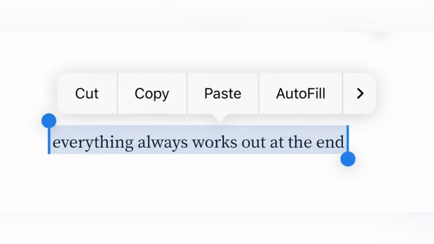

<p align="center">
  
</p>

<h1 align="center">永琪（Ari）</h1>

<p align="center">全栈研发</p>

<p align="center">南京邮电大学生物医学工程本科毕业。专注前端工程化，推动 AI 在业务场景中落地。</p>

<p align="center">
  <a href="https://intro.heyq02.com">intro.heyq02.com</a>
  &nbsp;·&nbsp;
  <a href="https://github.com/heyq02">GitHub</a>
  &nbsp;·&nbsp;
  <a href="https://x.com/heyq02">X</a>
  &nbsp;·&nbsp;
  <a href="https://space.bilibili.com/3493273159075938">Bilibili</a>
  &nbsp;·&nbsp;
  <a href="https://juejin.cn/user/708557910842296">掘金</a>
  &nbsp;·&nbsp;
  <a href="https://intro.heyq02.com/wechat.jpg">微信</a>
</p>

<p align="center">
  +86 135****8086
  &nbsp;·&nbsp;
  <a href="mailto:hello@heyq02.com">hello@heyq02.com</a>
</p>

## 经历

**[北京京东世纪贸易有限公司](https://www.jd.com/)** · 2024.06 – 至今

- 负责京东外卖跨端小程序&H5、管理后台需求迭代
- 进行管理后台老旧架构升级，TP95性能优化
- 本地生活产研C3层面 AI Infra 建设，提升研发效能

## 技能

<p>
  <picture>
    <source media="(prefers-color-scheme: dark)" srcset="https://simpleicons.dev/icons?icons=vuedotjs,react,nextdotjs,rolldown,vite,oxc,spring,redis,rabbitmq,nginx,docker&perline=6&theme=dark" />
    
  </picture>
</p>

[Vue](https://vuejs.org/) · [React](https://react.dev/) · [Next](https://nextjs.org/) · [Rolldown](https://rolldown.rs/) · [Vite](https://vite.dev/) · [Oxc](https://oxc.rs/) · [Spring](https://spring.io/) · [Redis](https://redis.io/) · [RabbitMQ](https://www.rabbitmq.com/) · [Nginx](https://nginx.org/) · [Docker](https://www.docker.com/)

## 开源

**[jd-opensource/taro-ui](https://github.com/jd-opensource/taro-ui)**

一款基于 Taro 框架开发的多端 UI 组件库

TypeScript · ★ 4.7k · 743

**[simpleicons.dev](https://github.com/heyq02/simpleicons.dev)**

Showcase your skills on your GitHub readme or resumé with ease.

TypeScript · ★ 171

## 终端

```sh
npx heyq02 intro
```
