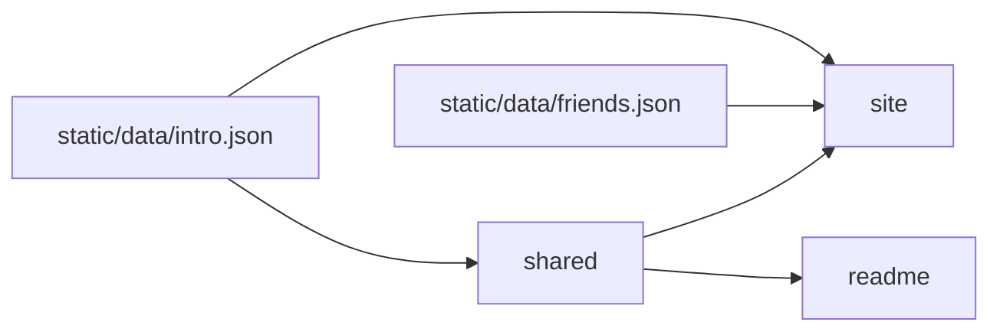

## Drivers

Three surfaces must stay in agreement without a CMS. English copy has one file (`goal`).

## Topology

pnpm workspace (`apps/*`, `packages/*`) on Node `>=22.12`, Vite Plus, and `@liangmi/vp-config`. The catalog pins Vite to `@voidzero-dev/vite-plus-core`. Root `dev` / `build` / `preview` target the site; root `pack` targets the CLI.

`intro.json` is the English SSOT. `shared` owns typed access (`intro`, `formatCount`) and the shared simpleicons.dev skills picture URL. The site and README import those helpers; the site Rspress config still reads `intro.json` directly for the shell, because app configs must not import `@heyq02/*`. The CLI does not use `shared`; every invocation fetches the published README from GitHub `main` and renders it in the terminal (`cli`). Friend links live in `friends.json` and are site-only (`/friends/`). Sponsor art is outside this graph: generated under `sponsorkit/`, not imported by any app.

## Decisions

- **English chrome.** The site is a GitHub Pages Rspress build. The homepage is a doc page of theme components, not the built-in homepage. Site chrome is English-only; there is no language switch. Blog posts may be Chinese. Owned by `site`.
- **Publish surface.** Today only the `heyq02` CLI is public on npm. The site deploys to GitHub Pages (`heyq02.com` via `CNAME`). `shared` and `readme` are private workspace packages/apps. This is what the repo enforces now, not a product non-goal (`goal`).
- **Tag releases.** A `v*` tag (or a manual run) publishes the CLI with npm OIDC trusted publishing (`vp pm stage publish`, provenance on). CLI publish does not use `--no-git-checks`; current Vite Plus rejects that flag on `stage publish`.
- **CI.** Pull requests and pushes to `main` run `vp run ccheck` and `vp test`.
- **Site deploy.** Pushes to `main`, or a manual run, deploy the site to GitHub Pages. Tag pushes do not.
- **README refresh.** Pushes to `main`, or a manual run, regenerate `README.md` on that ref. Tag pushes do not. The bot commit includes `[ci skip]`, so it does not start another run.
- **Sponsor art is generated, not displayed.** A daily job, plus pushes to `main`, runs SponsorKit (GitHub and Ko-fi tokens) and commits `sponsorkit/**`. Lint and format ignore that tree. Confirmed: not a visitor-facing surface.

## Invariants

- App Vite configs must not import `@heyq02/*`. `vp run` loads every app config before workspace packages are built. The site Rspress config reads `intro.json` for the title and description. Runtime code may import package exports (`shared`); site `cbuild` / `dev` wait on dependency builds when those packages expose a `build` task. The CLI does not import site or shared; it fetches the published README.
- Relative intro links (a leading `/`) stay root-relative in the site navbar for Rspress `img` social links (WeChat). Surfaces that need absolute URLs resolve them at the call site.
- The README and the site read identity facts through `shared`. Only the site Rspress config reads `intro.json` directly for shell meta. The CLI prints the published README; it does not read `intro.json` or `shared`.
- Coverage thresholds in the root Vite Plus config are 95% statements, branches, functions, and lines for app and package source. Commits are conventional (`@commitlint/config-conventional`).
