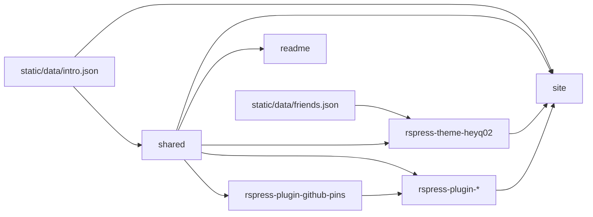

## Drivers

三个展示面（站点、CLI、README）必须保持一致，且没有 CMS。中文文案只有一份文件（`goal`）。

## Topology

pnpm workspace（`apps/*`、`packages/*`），Node `>=22.12`，Vite Plus，`@liangmi/vp-config`。catalog 把 Vite 固定到 `@voidzero-dev/vite-plus-core`。根 `dev` / `build` / `preview` 指向站点，根 `pack` 指向 CLI。

`intro.json` 是中文简介的唯一来源。`shared` 提供类型化访问（`intro`、`formatCount`）、共享的 simpleicons.dev 技能图 URL、导航栏 `socialLinksFrom`、站点 UI class token，以及生成文件工具。站点是 `rspress-theme-heyq02` 加 `rspress-plugin-*`（assets、blog meta、profile MDX）的轻薄组合。GitHub pin 是被 profile 插件调用的库，不是注册的站点插件。站点与 README 都引用 `shared` 的辅助函数；站点 Rspress 配置仍直接读取 `intro.json` 以获取外壳 meta，并从 `shared` 调用 `socialLinksFrom`。App 的 **Vite** 配置不得导入 `@heyq02/*`。CLI 不引用 `shared`；每次调用都从 GitHub `main` 拉取已发布的 README 并在终端渲染（`cli`）。友链数据在 `friends.json` 中，由主题消费（`/friends/`）。Sponsor 产物在图之外：在 `sponsorkit/` 下生成，不被任何 app 导入。`static/` 里还有站点不引用的素材库（自拍、签名变体）。

## Decisions

- **单语言中文站点。** 站点是 GitHub Pages 上的 Rspress 构建，`lang: 'zh'`、没有 `locales`、没有 `route.localeRedirect`，因此所有路由都在无前缀路径下。文章与页面直接提交在 `apps/site/blogs`（`blog/`、`friends.mdx`、`_nav.json`），不存在 `/zh/` 树、英文模板目录或翻译流水线。首页是按主题组件生成的 doc 页面，由 `rspress-plugin-profile` 写入 `blogs/index.mdx`。界面文案（导航、友链、侧边栏标签、`llms.txt`、RSS、代码块复制等）全部为中文。由 `site` 组合 + 主题/插件共同维护。样式是站点上的 Tailwind CSS v4（`@rsbuild/plugin-tailwindcss`），主题只保留少量 Rspress chrome CSS。Agent 面：SSG-MD + 自定义 `llms.txt` 与 WebMCP（Rspress ≥2.1）；agent 直接抓取 `.md` / `llms.txt`（GitHub Pages 不做 Accept 协商）。
- **发布面。** 目前只有 `heyq02` CLI 发布到 npm。站点部署到 GitHub Pages（`CNAME` 指向 `heyq02.com`）。主题/插件包与 `shared` / `readme` 都是私有 workspace 包。这是仓库当前强制的范围，不是产品层面的非目标（`goal`）。
- **打标签发布。** `v*` 标签（或手动触发）用 npm OIDC 可信发布（`vp pm stage publish`，开启 provenance）。CLI 发布不使用 `--no-git-checks`；当前 Vite Plus 在 `stage publish` 上不接受该参数。
- **CI。** PR 与推送到 `main` 会运行 `vp run ccheck`、`vp test`、`pnpm test:e2e`。
- **站点部署。** 推送到 `main` 或手动运行会把站点部署到 GitHub Pages；标签推送不触发。站点 `rspress` 在路由扫描前通过 `rspress-plugin-*` 的 `config` hook 重新生成首页 MDX、博客 `_meta.json` 与公共资源（这些产物被 gitignore）。
- **README 刷新。** 推送到 `main` 或手动运行会在该 ref 上重新生成 `README.md`；标签推送不触发。机器人提交带 `[ci skip]`，因此不会再次触发流水线。
- **Sponsor 图片只生成、不展示。** 每日任务加 `main` 推送会运行 SponsorKit（GitHub 与 Ko-fi token）并提交 `sponsorkit/**`。lint 与 format 忽略该目录。已确认：它不是面向访客的展示面。

## Invariants

- App 的 Vite 配置不得导入 `@heyq02/*`。`vp run` 会在 workspace 包构建前加载所有 app 配置。站点 Rspress 配置读取 `intro.json` 获取标题与描述，并可导入 `@heyq02/shared` 与无 scope 的 `rspress-plugin-*`。运行时代码可导入包导出（`shared`、主题/插件）。CLI 不导入站点或 `shared`；它拉取已发布的 README。
- intro 里的相对链接（以 `/` 开头）在站点导航栏中保持根相对，供 Rspress `img` 社交链接（微信）使用。需要绝对地址的展示层在调用处解析。
- README 与站点都通过 `shared` 读取简介事实。只有站点 Rspress 配置直接读取 `intro.json` 以获取外壳 meta。CLI 打印已发布的 README，不读 `intro.json` 或 `shared`。
- 根 Vite Plus 配置中的覆盖率门槛是 app 与包源码 95%（语句、分支、函数、行）。每个 `apps/*` 与 `packages/*` 都拥有单测和独立的 `e2e/` 套件（`pnpm test` / `pnpm test:e2e`）。提交信息遵循 conventional（`@commitlint/config-conventional`）。
