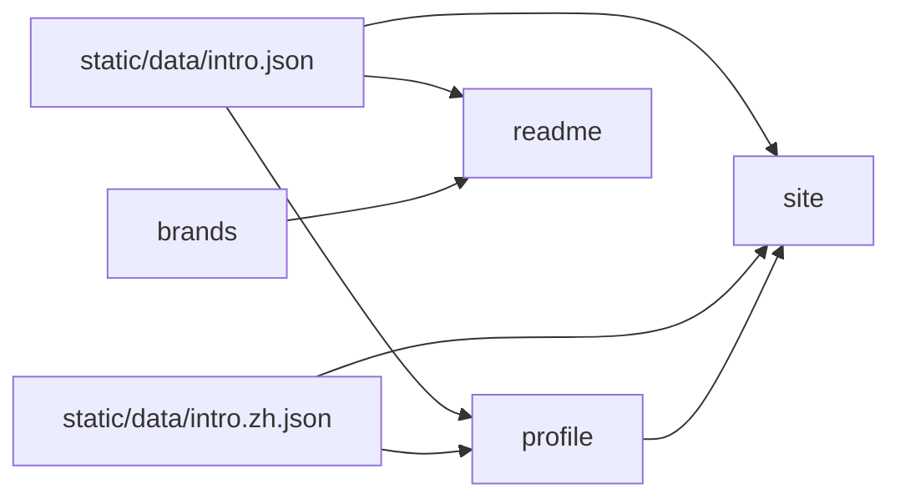

## Drivers

Three surfaces must stay in agreement without a CMS. English copy has one file. Chinese profile copy has one overlay on that file. Brand names have one map (`goal`).

## Topology

pnpm workspace (`apps/*`, `packages/*`) on Node `>=22.12`, Vite Plus, and `@liangmi/vp-config`. The catalog pins Vite to `@voidzero-dev/vite-plus-core`. Root `dev` / `build` / `preview` target the site; root `pack` targets the CLI.

`profile` is the typed API over the English file and the Chinese overlay. The site runtime reads that merge. The CLI does not. Every invocation fetches the published README from GitHub `main` and renders it in the terminal (`cli`). The site Rspress config reads both files for the shell, because app configs must not import `@heyq02/*`. The README generator reads only `intro.json` (`readme`). `brands` maps display names to simple-icons slugs and depends on neither package. Sponsor art is outside this graph: generated under `sponsorkit/`, not imported by any app.

## Decisions

- **Rspress locales, no hash.** The site is a GitHub Pages Rspress build. Chinese is the default language and has no prefix. English is `/en`. The theme switch writes that path. The browser's language is ignored. Link unfurls stay Chinese. Owned by `site`.
- **Chinese is an overlay, not a second profile.** Confirmed. Translated fields live in `static/data/intro.zh.json`. `profile` merges them onto the English intro and keeps the display name, title, links, start dates, counts, and skill names from English. Site, CLI, and README must not keep a private Chinese profile table. UI chrome that is not profile data stays in the site (`site`).
- **Publish surface.** Today only the `heyq02` CLI is public on npm. The site deploys to GitHub Pages (`heyq02.com` via `CNAME`). `profile`, `brands`, and `readme` are private workspace packages. This is what the repo enforces now, not a product non-goal (`goal`).
- **Tag releases.** A `v*` tag (or a manual run) publishes the CLI with npm OIDC trusted publishing (`vp pm stage publish`, provenance on). CLI publish does not use `--no-git-checks`; current Vite Plus rejects that flag on `stage publish`.
- **Site deploy.** Every branch push, or a manual run, deploys the site to GitHub Pages. Tag pushes do not. The job checks out `main`, so a push to another branch does not publish that branch.
- **README refresh.** Every branch push, or a manual run, regenerates `README.md` onto `main`. Tag pushes do not. The job checks out `main` so a push to another branch does not commit on that ref. The bot commit includes `[ci skip]`, so it does not start another run.
- **Sponsor art is generated, not displayed.** A daily job, plus pushes to `main`, runs SponsorKit (GitHub and Ko-fi tokens) and commits `sponsorkit/**`. Lint and format ignore that tree. Confirmed: not a visitor-facing surface.

## Invariants

- App Vite configs must not import `@heyq02/*`. `vp run` loads every app config before workspace packages are built. The site Rspress config reads `intro.json` for the English description and `intro.zh.json` for the default Chinese description. Runtime code imports package exports, and site `cbuild` / `dev` wait on dependency builds. The CLI no longer bundles `profile`.
- Relative profile links (a leading `/`) are absolutized against the site origin before a surface treats them as external URLs. `profile` does this for its exports; the site's Chinese places do it the same way.
- The README stays English and reads `intro.json`, never `intro.zh.json` or a site-local Chinese table. The CLI prints that published README; it does not read `profile`.
- Coverage thresholds in the root Vite Plus config are 95% statements, branches, functions, and lines for app and package source. Commits are conventional (`@commitlint/config-conventional`).
