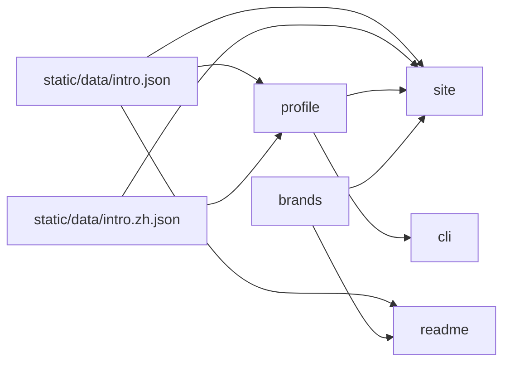

## Drivers

Three surfaces must stay in agreement without a CMS. English copy has one file. Chinese profile copy has one overlay on that file. Brand names have one map (`goal`).

## Topology

pnpm workspace (`apps/*`, `packages/*`) on Node `>=22.12`, Vite Plus, and `@liangmi/vp-config`. The catalog pins Vite to `@voidzero-dev/vite-plus-core`. Root `dev` / `build` / `preview` target the site; root `pack` targets the CLI.

`profile` is the typed API over the English file and the Chinese overlay, and the only runtime reader of that overlay. The site Vite config also reads both files for the shell, because app configs must not import `@heyq02/*`. README still reads only `intro.json`. `brands` maps display names to simple-icons slugs and depends on neither package. Sponsor art is outside this graph: generated under `sponsorkit/`, not imported by any app.

## Decisions

- **Hash locale, no router.** The site is a GitHub Pages SPA. Language is `#lang=en` or `#lang=zh` (short aliases accepted). Default is Chinese. The browser's language is ignored. Owned by `site`.
- **Chinese is an overlay, not a second profile.** Confirmed. Translated fields live in `static/data/intro.zh.json`. `profile` merges them onto the English intro and keeps the display name, title, links, start dates, counts, and skill names from English. Site, CLI, and README must not keep a private Chinese profile table. UI chrome that is not profile data stays in the site (`site`).
- **Publish surface.** Today only the `heyq02` CLI is public on npm. The site deploys to GitHub Pages (`heyq02.com` via `CNAME`). `profile`, `brands`, and `readme` are private workspace packages. This is what the repo enforces now, not a product non-goal (`goal`).
- **Tag releases.** A `v*` tag (or a manual run) publishes the CLI with npm OIDC trusted publishing (`vp pm stage publish`, provenance on), deploys the site, and regenerates `README.md` onto `main`. The README job checks out `main` because a tag checkout is detached. CLI publish does not use `--no-git-checks`; current Vite Plus rejects that flag on `stage publish`.
- **Sponsor art is generated, not displayed.** A daily job, plus pushes to `main`, runs SponsorKit (GitHub and Ko-fi tokens) and commits `sponsorkit/**`. Lint and format ignore that tree. Confirmed: not a visitor-facing surface.

## Invariants

- App Vite configs must not import `@heyq02/*`. `vp run` loads every app config before workspace packages are built. The site config reads `intro.json` for the HTML title (the English name) and `intro.zh.json` for the default description. Runtime code imports package exports, and site `cbuild` / `dev` wait on dependency builds. The CLI pack always bundles `profile` from `dist/`.
- Relative profile links (a leading `/`) are absolutized against the site origin before a surface treats them as external URLs. `profile` does this for its exports; the site's Chinese places do it the same way.
- English copy is not forked into the CLI or README. Those surfaces read `intro.json`, `intro.zh.json`, or `profile`, never a site-local Chinese table.
- Coverage thresholds in the root Vite Plus config are 95% statements, branches, functions, and lines for app and package source. Commits are conventional (`@commitlint/config-conventional`).
